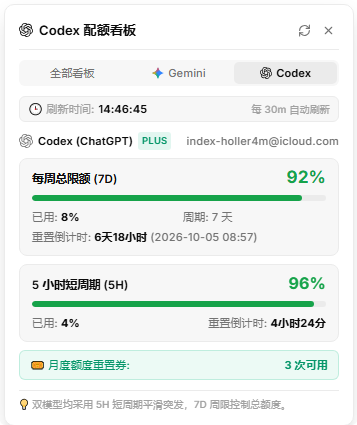

# AI 配额与用量监控

CC GUI 的 AI 配额与用量查询插件。当前支持 **Google Antigravity（Gemini）**、**OpenAI Codex** 与 **CodeBuddy 账号积分余额**。

## 功能

- 在底部状态栏显示剩余额度与积分摘要，点击后可查看单个模型的专属看板。
- **单个模型独立看板**：支持 Gemini 配额看板、Codex 配额看板与 CodeBuddy 账号积分看板，告别拥挤堆叠。
- 展示 7 天周限、5 小时短周期额度、CodeBuddy 月度总积分额度、已用积分与重置时间。
- 按当前会话使用的引擎自动智能聚焦，也可在设置中选择固定展示模式。

## 使用要求

- CC GUI 插件 SDK `>=0.3.7`。
- **Antigravity / Gemini**：安装 `omp` 命令行工具，并在 Antigravity 中完成登录。
- **Codex**：安装 Node.js，并通过 Codex CLI 登录，使本机存在 `~/.codex/auth.json`。
- **CodeBuddy**：安装 Node.js，并在 CodeBuddy / WorkBuddy 客户端或 CLI 中完成登录。

插件会检查对应本地工具和登录状态。没有登录或依赖缺失时，该服务的卡片会显示错误；刷新超时则继续显示上次成功的数据。

## 权限与数据流

插件只查询用量，不读取聊天内容或项目文件。

- `exec:omp`：运行 `omp usage --provider google-antigravity --json`。Antigravity 的凭证及服务通信由本机 OMP 处理；插件读取并展示其返回的额度报告。
- `exec:node`：读取 `~/.codex/auth.json` 中的 Codex 登录访问令牌。令牌仅用于当前查询，不写入插件存储或日志。
- `network:chatgpt.com`：通过 CC GUI 的网络代理向 `chatgpt.com` 请求 Codex 用量。
- `network:copilot.tencent.com`：向腾讯云 `copilot.tencent.com` 请求 CodeBuddy 账号配额与积分用量。
- `storage`：在插件隔离存储中保存额度缓存和显示设置。
- `events`：读取当前会话的引擎标识，用于状态栏自动聚焦；不读取会话消息。
- 插件设置页由宿主根据 configSchema 显示自动刷新周期、状态栏模式和告警阈值；ui:status-bar 与 ui:command 提供底栏摘要及手动刷新命令。

插件不向插件作者或其他服务发送数据。Codex 用量请求只发往声明的 `chatgpt.com` 域名；CodeBuddy 请求发往 `copilot.tencent.com` 域名；Antigravity 查询由本机 OMP 完成。

## 刷新与设置

可以在插件设置中调整自动刷新间隔（0 表示关闭自动刷新）、底部状态栏显示模式和低额度阈值，也可以点击状态栏弹窗中的刷新按钮或使用命令面板里的“AI 配额: 刷新用量与积分”。

## 开发与打包

源码入口为 src/main.js，根目录 main.js 是可直接从本地目录安装的入口。插件没有运行时外部模块依赖。manifest.json 声明插件信息、权限与设置项，styles.css 定义状态栏和弹窗样式。

运行 pnpm build 会同步本地安装入口并生成 dist/ 发布包；pnpm validate 检查 manifest、权限声明、README 图片和发布产物。推送与 manifest 版本一致的 Git tag 后，GitHub Actions 会构建并发布安装所需的三个文件。
