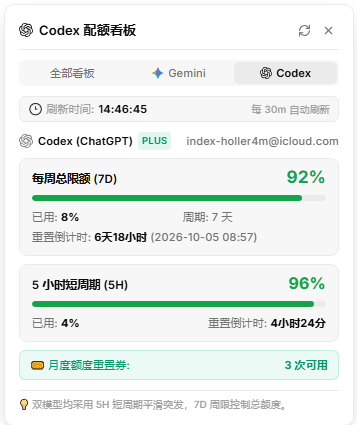
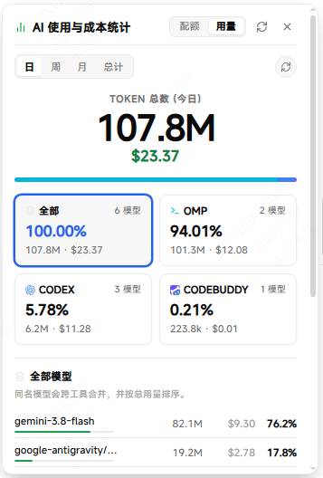
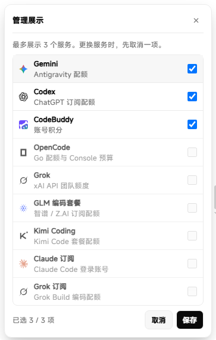

# AI 配额与用量监控

在 CC GUI 状态栏查看 AI 服务的订阅配额、账号积分与本地 Token 用量。支持 **Gemini**、**Codex**、**CodeBuddy**、**OpenCode**、**GLM 编码套餐**、**Kimi Coding**、**Claude 订阅**、**Grok 订阅**与 **xAI API 团队额度**，可自选最多三个服务，通过页签快速切换。

用量看板按日、周、月和总计展示 Token 消耗、估算成本、引擎与模型明细，并提供每日用量热力图。各服务需要的登录、授权或 API Key 见下方使用要求。

## 功能

- 在底部状态栏显示剩余额度与积分摘要，点击后呼出详细看板。
- **按服务查看**：使用页签切换服务。「管理展示」最多勾选三个，隐藏后停止查询。默认显示 Gemini、Codex 和 CodeBuddy。旧设置超过三项时，按原顺序保留前三项。
- **全场景 Token 与成本统计**：一键切换至用量看板，支持查看今日、本周、本月与全部时间的 Token 总量、费用、各引擎占比与模型用量明细。
- **GitHub 风格用量热力图**：直观展示近半年 24 周的每日 Token 消耗活跃度分布与 5 级渐变色块图例。
- **多维度周期与指标**：展示 7 天周限、5 小时短周期额度、CodeBuddy 月度总积分额度、周期推进进度、重置倒计时及专属权益/重置券条目。
- 按当前会话使用的引擎自动智能聚焦，也可在设置中选择固定展示模式。

## 自定义展示服务

打开配额看板，点击「管理展示」，勾选常用服务后保存。最多同时展示三个服务；达到上限后，先取消一项，再勾选新服务。隐藏的服务停止查询，默认展示 Gemini、Codex 和 CodeBuddy。

## 使用要求

- CC GUI 1.2.1 及以上（插件 SDK 0.3.25 及以上）。Grok 订阅和复用官方套餐渠道需要包含相应配额接口的宿主。
- **Antigravity / Gemini**：支持通过 Antigravity CLI (`agy`) 或 `omp` 查询，并在 Antigravity 中完成登录。插件默认开启智能探测：优先尝试 `agy` CLI，若未安装或执行异常则自动平滑回退至 `omp`。
- **Codex**：安装 Node.js，并通过 Codex CLI 登录，使本机存在 `~/.codex/auth.json`。
- **CodeBuddy**：安装 Node.js，复用 CodeBuddy CLI 的登录文件。只读取应用数据目录下的 `CodeBuddyExtension/Data/Public/auth/Tencent-Cloud.coding-copilot.info`（Windows 根目录为 `%LOCALAPPDATA%`，macOS 为 `~/Library/Application Support`，Linux 为 `$XDG_DATA_HOME` 或 `~/.local/share`）。不遍历目录、不读取 WorkBuddy 或其他认证文件。需要该文件中存在有效的明文访问令牌；新版 CLI 的加密凭据及 IDE 的加密登录存储目前不支持，IDE 重新登录不会更新此文件。
- **OpenCode**：打开页签时优先查询已运行的 OpenCode 2 本地服务。启用本地查询前，在 OpenCode 2 连接 Console 工作区并运行 `opencode serve --hostname 127.0.0.1 --port 4096`，本地服务设了密码时可手动输入。也可复用 CC GUI 已启用的 OpenCode Go 渠道或手填 Go API Key。[OpenCode 服务文档](https://opencode.ai/docs/cli/web)
- **GLM 编码套餐**：优先使用 CC GUI 已启用的官方套餐渠道。也可选择智谱中国区或 Z.AI 国际版并手填套餐 API Key。[智谱套餐接入文档](https://docs.bigmodel.cn/cn/coding-plan/extension/coding-tool-helper)
- **Kimi Coding**：优先使用 CC GUI 已启用的 Kimi Coding 渠道，也可手填 Kimi Code 套餐 API Key。
- **Claude 订阅**：先在 Claude Code 登录，再在插件中连接 CLI 账号并授权查询。
- **Grok 订阅**：在 Grok Build 中通过浏览器登录个人账号，再在插件中连接 CLI 账号并单独授权。显示 Grok Build 当前订阅周期的编码配额。[Grok Build 登录文档](https://github.com/xai-org/grok-build/blob/main/crates/codegen/xai-grok-pager/docs/user-guide/02-authentication.md)
- **Grok（xAI API 团队）**：在 xAI Console 获取 Team ID 和具有账单读取权限的 Management API Key。可查看 API 预付余额与后付费月度上限。[xAI 管理接口](https://docs.x.ai/developers/rest-api-reference/management/billing)

插件会检查对应本地工具和登录状态。没有登录或依赖缺失时，该服务的卡片会显示错误；刷新超时则继续显示上次成功的数据。

## 权限与数据流

配额查询读取服务返回的限额。用量页从本机会话日志提取 Token 和成本统计。

- `exec:agy`：运行 `agy -p /quota --output-format json` 获取 Antigravity 配额，智能首选。
- `exec:omp`：运行 `omp usage --provider google-antigravity --json` 获取 Antigravity 配额，作为智能降级兜底。
- `exec:node`：读取 `~/.codex/auth.json` 中的 Codex 登录访问令牌，以及上文指定的 CodeBuddy CLI 登录文件，并运行本地 TokenTracker 用量统计。登录令牌仅用于向对应服务查询，不写入插件存储或日志。
- `network:chatgpt.com`：通过 CC GUI 的网络代理向 `chatgpt.com` 请求 Codex 用量。
- `network:copilot.tencent.com`：向腾讯云 `copilot.tencent.com` 请求 CodeBuddy 账号配额与积分用量。
- `network:127.0.0.1:4096`：读取当前连接的 OpenCode 本地服务的 Go 配额和 Console 预算。
- `network:management-api.x.ai:443`：向 xAI Management API 只读查询团队账单额度。
- `network:opencode.ai:443`、`network:open.bigmodel.cn:443`、`network:api.z.ai:443`、`network:api.kimi.com:443`：使用填写的套餐 API Key 查询对应服务的配额。
- `limits.read`：向 CC GUI 宿主请求 Claude Code 与 Grok Build 的额度窗口。登录凭据由宿主在授权后读取。拒绝后，可从插件详情页检查或更改授权。
- `storage`：保存原有服务的额度缓存、展示列表及其他设置。输入的 API Key 和服务密码仅用于当次运行，隐藏或断开服务后清除。
- `events`：读取当前会话的引擎标识，用于状态栏自动聚焦；不读取会话消息。
- 插件设置页由宿主根据 configSchema 显示自动刷新周期、状态栏模式和告警阈值；ui:status-bar 与 ui:command 提供底栏摘要及手动刷新命令。

Codex 用量请求只发往声明的 `chatgpt.com` 域名；CodeBuddy 请求发往 `copilot.tencent.com` 域名；Antigravity 查询由本机 agy 或 omp 完成。

## 刷新与设置

可以在插件设置中调整自动刷新间隔（0 表示关闭自动刷新）、底部状态栏显示模式和低额度阈值。弹窗中的刷新按钮更新当前服务或用量视图。「AI 配额: 刷新用量与积分」命令会刷新所有可见且已连接的服务和本地用量。Claude 和 Grok 订阅通过连接按钮或手动刷新查询。

## 开发与打包

界面源码在 src/main.js，配额接口在 src/quota-services.js。两者在构建时合为根目录的 main.js，可直接从本地目录安装。插件没有运行时外部模块依赖。manifest.json 声明插件信息、权限与设置项，styles.css 定义状态栏和弹窗样式。

运行 pnpm test 执行配额接口和展示偏好测试。pnpm build 会同步本地安装入口并生成 dist/ 发布包；pnpm validate 检查 manifest、权限声明、README 图片和发布产物。推送与 manifest 版本一致的 Git tag 后，GitHub Actions 会构建并发布安装所需的文件。
